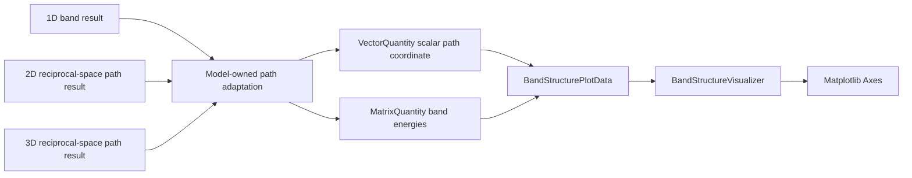
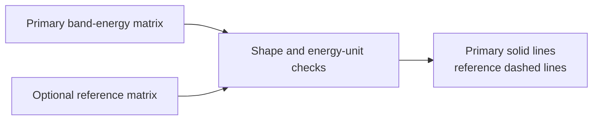

# Solid-state visualization schematics

## Dimension-independent band rendering



The visualizer consumes a scalar parameterization of an already selected path.
It does not inspect the dimension of the reciprocal vectors used to construct
that path.

## Optional reference overlay



Notebook or model code owns the scientific meaning of the reference, such as an
exact free-particle spectrum or a convergence baseline.

## One-dimensional sampled Bloch states

```mermaid
flowchart LR
    POS[Uniform endpoint-excluded positions]
    PSI[Complex Bloch amplitudes psi_k]
    K[Explicit Bloch wave number k]
    DATA[BlochState1DPlotData]
    STATE[Amplitude, density, phase]
    REMOVE[Remove exp(ikx)]
    FFT[Cell-periodic FFT weights]

    POS --> DATA
    PSI --> DATA
    K --> DATA
    DATA --> STATE
    DATA --> REMOVE --> FFT
```

The full twisted state is rendered in real space. Reciprocal integer labels
belong to the periodic factor $u_k=e^{-ikx}\psi_k$, not directly to the
nonperiodic carrier-bearing samples.

## Navigation

- [Package index](index.md)
- [Numeric contract](numeric.md)
- [Scientific contract](scientific.md)
