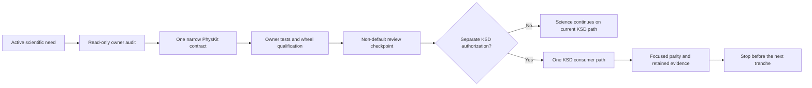

# Staged migration of reusable KSD capabilities into PhysKit

This task records an owner-led migration strategy for reusable behavior that currently
lives in `ksdft2effmass`. It deliberately rejects a big-bang migration: scientific work
must be able to continue while each small owner contract is designed, qualified, and
adopted independently.

## Operating principles

Each tranche must be small enough to review and useful without authorizing its
successor.

- PhysKit defines reusable physics contracts independently; KSD source is donor evidence,
  not the authority for PhysKit API shape.
- KSD may continue using stable local implementations while an owner replacement is
  unavailable or not yet adopted.
- One PhysKit extraction does not authorize a KSD migration, local deletion, subsequent
  extraction, merge, release, or scientific claim.
- Migrate one coherent vertical use case at a time instead of converting the entire KSD
  object graph.
- Preserve exact basis, gauge, unit, energy-reference, geometry, and ordering evidence
  at every boundary.
- Use nominal records and explicit conversion boundaries; do not introduce structural
  protocols or a PhysKit dependency on KSD.
- Optimization remains the owner of generic Fourier, norm, spectrum, assignment,
  decomposition, and Procrustes arithmetic.

## Ownership boundary

Reusable physical representation and campaign policy must remain distinct.

- PhysKit owns unit-aware quantities, lattice and reciprocal representations, band
  subspace records, physical adapters around numerical transforms, hopping models,
  and threshold-free diagnostics.
- Optimization owns generic numerical definitions, algorithms, backend execution, and
  backend evidence.
- KSD owns campaign topology, mesh and cutoff choices, named strain paths,
  normalization, thresholds and dispositions, scientific interpretation, acceptance,
  serializers, artifact schemas, workflow state, and retained calculations.
- Quantum ESPRESSO and Wannier90 retain their existing electronic-structure and
  localization ownership.

## Crystallography and unit ownership ledger

PhysKit is the destination owner for reusable crystallographic and unit semantics even
when a current implementation lives in KSD.

- Crystallographic ownership includes Bravais classifications and metric compatibility,
  direct/reciprocal lattices, duality, metrics, coordinate conventions, periodic
  structures and sites, fractional bases, exact coordinate bridges, crystal factories,
  symmetry operations, and named homogeneous deformation paths.
- Reciprocal ownership includes primitive cells, reduced and Cartesian coordinates,
  mode bases, meshes, generic neighbor-wrap mechanics, finite-basis sewing, and reusable
  k-point sampling representation.
- Path ownership includes Bain, diamond-decorated Bain, rhombic deformation,
  reciprocal-space paths, and reusable frame/projector/operator path records.
- Unit ownership includes physical and unitless identities, scalar/vector/matrix/sparse
  quantities, Pint registry and conversion behavior, and immutable unit-bearing
  numerical records.
- Calculator-native fields, pseudopotential bindings, external-format scaling,
  campaign normalization and sampling choices, workflow routes, tolerances,
  convergence, diagnostics, artifacts, and acceptance remain with KSD.
- Existing KSD implementations may continue supporting science as frozen donor/legacy
  code until each small owner contract and consumer migration is separately accepted.

Ownership does not imply one big-bang extraction.

- Begin with the unit-volume Bravais Bain path.
- Handle the diamond-decorated basis and FCC-to-Bain coordinate bridge separately.
- Handle the 2D rhombic path separately.
- Reconcile lattice, structure, reciprocal, symmetry, and quantity families one active
  scientific use case at a time.
- Do not infer implementation, KSD migration, removal, or successor authorization from
  this ledger.

## Current correction

The provisional reciprocal-path branch demonstrated why owner ordering matters.

- PhysKit commit `ac88b1e8320f51267a6625570d3698e25904ecd7` is not an accepted
  owner contract or KSD migration target.
- It mirrored KSD's one-dimensional names before reconciling PhysKit's existing
  reciprocal abstractions and the nominal quantity boundary.
- KSD quantity classes and PhysKit quantity classes have distinct runtime identities,
  so direct consumption fails exact nominal checks.
- KSD has stopped that consumer migration and retains its existing implementation.
- Disposition of the provisional remote branch requires a separate explicit decision.

## First bounded owner audit

The initial read-only audit found an internal PhysKit identity conflict that must be
resolved before any KSD reciprocal extraction.

- `projectkoios.physkit.periodic.lattice.lattice1d.ReciprocalLattice1D` is the
  public-façade identity, implements the common lattice contract, supports independent
  construction and `from_direct_lattice(...)`, and has mapped tests.
- `projectkoios.physkit.periodic.reciprocal.ReciprocalLattice1D` is a distinct legacy
  identity that retains its source direct lattice and is not exported from the periodic
  façade.
- Both identities produce the same positive reciprocal scale when derived from the same
  positive direct-lattice constant, but they are nominally incompatible and expose
  different attributes.
- `ReciprocalModeBasis1D` consumes the legacy identity and reads a nonexistent
  `fundamental_vector` attribute; ordinary construction currently raises
  `AttributeError`.
- The electronic and phonon band visualizers import the legacy identity and also read
  the nonexistent attribute.
- `BlochMode1D`, the plane-wave electronic Hamiltonian, and its solver depend on the
  affected basis family, while no focused tests currently bind this chain.

The recommended first implementation tranche is an internal owner repair, not an
extraction.

- Keep `periodic.lattice.lattice1d.ReciprocalLattice1D` as the canonical nominal
  identity.
- Update `ReciprocalModeBasis1D` to consume that identity and obtain vectors through its
  existing `vector(...)` operation.
- Update affected PhysKit consumers to use the canonical identity and its declared
  surface instead of inventing a compatibility attribute.
- Add focused basis, mode, Hamiltonian, solver, and visualizer tests before changing any
  KSD consumer.
- Preserve current dimensionless lattice semantics during this repair; unit-aware
  reciprocal representation remains a separate tranche.
- Do not remove the legacy module, add sewing, generalize dimensions, or migrate KSD in
  the same change.

## Stage 1: quantity-boundary audit

After the internal repair, begin with evidence rather than a repository-wide type
replacement.

- Compare KSD `operators/quantities.py` with
  `projectkoios.physkit.units.quantities` field by field and operation by operation.
- Inventory exact-type checks, converter calls, affine-unit behavior, serializers,
  fixtures, persisted schemas, and public re-exports in KSD.
- Identify whether one bounded consumer path can use direct PhysKit identities or needs
  an explicit KSD-side nominal conversion action during migration.
- Do not relax PhysKit type checks, add duck-typed protocols, or create a reverse
  dependency.
- Deliver only the smallest migration decision needed by the first scientific use case;
  do not migrate all KSD quantities merely to complete this stage.

## Stage 2: lattice reconciliation

Reconcile one required lattice capability rather than copying the full KSD lattice
family.

- Compare existing PhysKit `DirectLattice1D/2D/3D`, reciprocal lattices,
  `DirectLatticeMetric`, and `BravaisLattice` with KSD `bravais.py`, `lattices.py`, and
  `duality.py`.
- Fix one concrete missing owner contract required by active science.
- Preserve PhysKit's basis orientation and nominal identities.
- Defer the full Bravais taxonomy, verified lattice compositions, or unit-aware duality
  until an authorized use case requires each capability.
- Keep KSD local behavior available until the corresponding PhysKit contract and
  downstream parity evidence exist.

## Stage 3: reciprocal representation

Design the reciprocal API from PhysKit's dimensional model and current scientific need.

- Compose Optimization's `CenteredUniformMesh` rather than reproducing generic mesh
  arithmetic.
- Represent reduced coordinates, physical reciprocal bases, ordered integer modes, and
  units explicitly.
- Prefer a dimension-aware contract that can extend to one, two, and three dimensions;
  implement only the dimensions needed by the authorized tranche.
- Represent sewing by an explicit reciprocal integer translation and finite-basis
  behavior rather than copying separate KSD 1D and 2D class families.
- Use KSD `solid_state/reciprocal_paths.py` and its focused tests as provenance and
  behavioral evidence, not as mandatory destination API names.

## Stage 4: band frames and projectors

Extract reusable frame records only after reciprocal identity is stable.

- Own orthonormal frame-path and projector records in PhysKit.
- Delegate generic Procrustes and decomposition arithmetic to Optimization.
- Retain raw overlap, rank, residual, and closure evidence without assigning scientific
  acceptance.
- Leave reciprocal-neighbor selection, loop topology, closure interpretation, and
  plaquette policy in KSD.
- Migrate one explicit frame-analysis call path before considering broader frame APIs.

## Stage 5: reciprocal operators and hopping

Adapt physical operator samples to existing owners instead of copying KSD numerical
implementations.

- Reuse PhysKit `BlockHoppingModel`, Bloch, band, diagnostics, and conjugate-closed
  truncation contracts.
- Reuse Optimization centered matrix Fourier transforms, evaluation, Parseval evidence,
  and Hermiticity diagnostics.
- Add only the unit-aware correlation records and physical adapters missing from
  PhysKit.
- Keep shell/range selection, normalization, tolerances, error budgets, and acceptance
  in KSD.
- Do not copy KSD FFT, interpolator, block-model, or truncator implementations.

## Stage 6: Wilson representations

Separate reusable circular-phase representation from scientific interpretation.

- PhysKit may own principal-branch Wilson spectra, explicit center conventions, and
  threshold-free circular matching evidence.
- Optimization owns generic assignment arithmetic when a reusable owner operation is
  required.
- KSD retains tolerances, pass/fail dispositions, band or plaquette correspondence,
  topology, polarization, and scientific conclusions.
- Start only when an active scientific workflow needs the reusable contract.

## Per-tranche workflow

Every tranche follows the same bounded sequence and stops after its declared outcome.

- State the exact source, tests, conventions, and excluded policy before implementation.
- Publish immutable PhysKit evidence on a non-default branch before any consumer pin.
- Require separate KSD authorization for one consumer migration.
- Preserve the prior KSD path until focused parity and rollback evidence are available.
- Do not remove donor code merely because one consumer succeeds.
- Report numerical verification separately from scientific validation and human
  acceptance.

## Progress safeguards

Migration must support science rather than becoming a prerequisite for all future work.

- Prefer the smallest capability that removes a current blocker or material duplication.
- Time-box read-only inventories and avoid speculative generalization beyond foreseeable
  dimensions and consumers.
- Allow scientific campaigns to proceed with reviewed local code while owner work is
  pending.
- Revisit migration priority when scientific needs change.
- Stop and ask for a decision when units, basis orientation, gauge, topology, or public
  identity remain materially ambiguous.
- Never infer the next tranche from completion of the current one.

## Completion criteria

This migration task is complete only through separately accepted incremental outcomes.

- Each migrated capability has one authoritative owner and no active duplicate generic
  implementation.
- PhysKit has no dependency on KSD.
- KSD retains only campaign-specific policy or deliberate compatibility re-exports of
  exact owner identities.
- Every removed local implementation has focused parity evidence and an authorized
  consumer transition.
- Scientific campaigns remain reproducible throughout the migration rather than waiting
  for the entire roadmap to finish.
